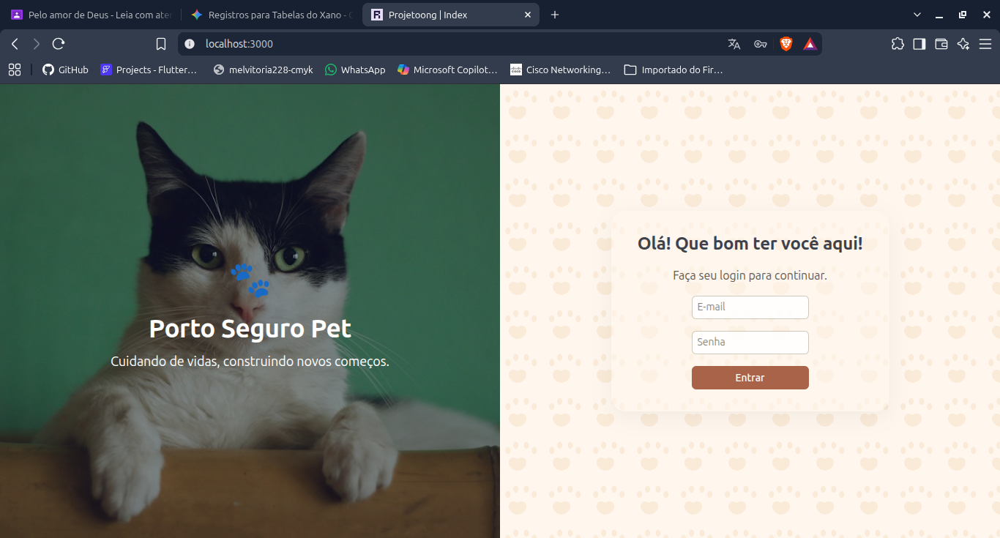

# 🐾 Porto Seguro Pet

Sistema web desenvolvido para centralizar e organizar a gestão operacional e administrativa de uma ONG de proteção animal, acompanhando todo o ciclo de vida dos animais resgatados — desde os cuidados iniciais e acolhimento em lares temporários até a adoção responsável e o acompanhamento pós-adoção.

---

## 1. Apresentação

### O Problema
A rotina de uma ONG de proteção animal envolve diversas frentes simultâneas: cadastro de animais resgatados, agendamentos e prontuários veterinários, controle de ocupação de lares temporários, triagem de adoções, acompanhamento pós-adoção, gestão de voluntários e registro de doações. Quando essas informações ficam dispersas em planilhas ou anotações manuais, torna-se difícil consultar históricos, evitar cadastros duplicados e manter o status atualizado de cada animal.

### A Solução
O **Porto Seguro Pet** oferece uma plataforma web única e centralizada que integra os processos internos da instituição e conecta a equipe administrativa aos adotantes.

### Público-Alvo
- **Equipe Gestora e Voluntários Administrativos da ONG:** responsáveis pelo cadastro, triagem, acompanhamento clínico e gestão operacional.
- **Tutores e Interessados em Adoção:** pessoas vinculadas a processos de adoção que acompanham suas solicitações, registros de pós-adoção, dados cadastrais e orientações de guarda responsável.

---

## 2. Acesso ao Aplicativo

- **Execução da aplicação:** Execução local via Reflex (`http://localhost:3000`), conforme o passo a passo abaixo.
- **Repositório GitHub:** `[INSIRA AQUI O LINK DO SEU REPOSITÓRIO PÚBLICO]`

### Como executar localmente
1. Clone o repositório e acesse a pasta do projeto:
   ```bash
   git clone [INSIRA-AQUI-O-LINK-DO-REPOSITORIO].git
   cd ProjetoONG

3. Copie o arquivo `.env.example` para `.env` na raiz do projeto e preencha as variáveis de ambiente configuradas para a API **Xano** (os demais endpoints já estão mapeados nos estados dos módulos).


## 3. Manual de utilização

### 3.1. Acesso ao Sistema 
* **Ações:** Acesse `/` e informe **E-mail** e **Senha**. 
* **Resultado esperado:** O sistema redireciona automaticamente administradores para `/administrativo` e tutores para `/tutor`.



---

### 4. Jornada do Administrador

#### 1 Painel Administrativo (`/administrativo`)
* **Ações:** Visualize os indicadores gerais da ONG e navegue pelos módulos pelo menu lateral esquerdo.
* **Resultado esperado:** Acesso rápido e centralizado a todas as áreas de gestão.


#### 2 Gestão de Animais (`/animais`)
* **Ações:** Clique em **Novo Animal**, preencha os dados básicos e clínicos (espécie, porte, alergias, restrições e status) e salve. Utilize os filtros para buscar ou editar registros.
* **Resultado esperado:** O animal é cadastrado e exibido na listagem com o status atualizado.


#### 3 Lares Temporários (`/lares-temporarios`)
* **Ações:** Cadastre lares parceiros com capacidade de vaga e vincule animais informando a data de entrada (e data de saída ao encerrar o acolhimento).
* **Resultado esperado:** Controle de ocupação atualizado e histórico completo de acolhimentos preservado.


#### 4 Atendimento Veterinário (`/atendimento-veterinario`)
* **Ações:** Clique em **Novo Atendimento**, selecione o animal, data, veterinário e status (`Agendado`, `Realizado` ou `Cancelado`). Quando realizado, preencha peso, diagnóstico, tratamento e custo.
* **Resultado esperado:** Histórico clínico vinculado ao prontuário do animal.


#### 5. Processos de Adoção (`/adocoes`)
* **Ações:** Analise os dados do solicitante e atualize o status do processo (`Em análise`, `Aprovada`, `Não aprovada` ou `Adoção efetivada`).
* **Resultado esperado:** Ao marcar como **`Adoção efetivada`**, o status do animal muda automaticamente para **`Adotado`** e encerra eventual lar temporário ativo.


#### 6. Pós-Adoção, Doações e Voluntários (`/pos-adocao`, `/doacoes`, `/voluntarios`)
* **Ações:** Registre relatos de adaptação em **Pós-Adoção**, cadastre doadores e doações financeiras/materiais em **Doações**, e organize voluntários e atividades em **Voluntários**.
* **Resultado esperado:** Prestação de contas consolidada, histórico de atividades por voluntário e acompanhamento pós-adoção visível para a ONG e para o tutor.


---

### 7 Jornada do Tutor / Adotante (`/tutor`)
* **Ações:** Após o login, consulte o status dos seus processos de adoção, leia os relatórios de acompanhamento pós-adoção, acesse o guia de orientações de cuidados e utilize a área de **Meus Dados** para atualizar seus dados cadastrais ou alterar sua senha.
* **Resultado esperado:** Acompanhamento transparente de todas as etapas da adoção em tempo real e autonomia para manter dados e senha atualizados.


